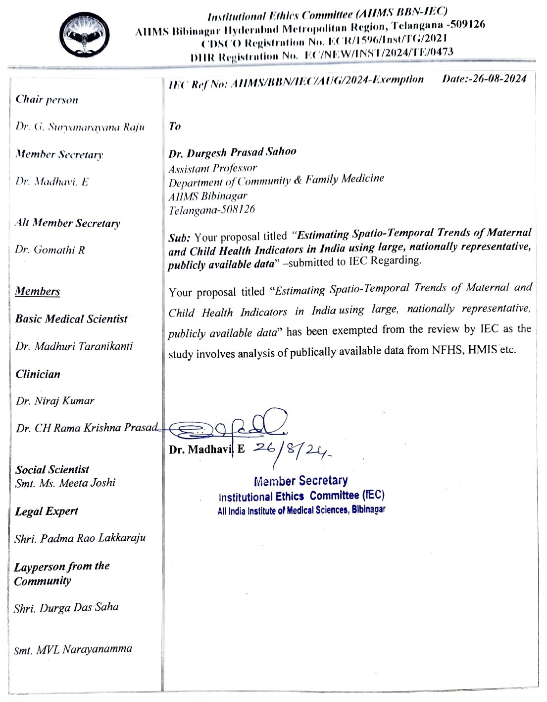

## Background and objectives

:::: {.columns}

::: {.column width="64%"}
- MCH indicators in India have improved, but large regional and district-level disparities remain.
- NFHS-6 (2023–24) was released on 29 May 2026: the first post-COVID round.
- With NFHS-4 and NFHS-5, it gives three district-level rounds to model trends, not just snapshots.

**Objectives**

1. Study spatio-temporal patterns of MCH indicators at state and district level across NFHS-4, 5 and 6.
2. Investigate spatial clustering across districts, and how clusters persist or emerge between rounds.
3. Identify and analyse factors influencing the observed spatial and temporal trends.
:::

::: {.column width="34%"}
{.iec fig-alt="IEC exemption letter, AIIMS Bibinagar, Ref AIIMS/BBN/IEC/AUG/2024-Exemption, dated 26-08-2024"}
:::

::::

## Data sources

| Source | Period | Level | Status (Oct 2026) |
|:---|:---|:---|:---|
| NFHS-6 | 2023–24 | State and district fact sheets; unit-level when released | Fact sheets out (May 2026); report and unit-level data awaited |
| NFHS-5 | 2019–21 | State, district; unit-level | Available |
| NFHS-4 | 2015–16 | State, district; unit-level | Available |
| HMIS | 2011 onwards | Facility, district; monthly | Available |

Covariates: SEDAC and SHRUG. Boundaries: Survey of India.

## Methods

**Preprocessing**

- Extract indicators with consistent definitions across NFHS-4, 5 and 6.
- Harmonise districts to a common frame (crosswalk, population-weighted).

**Analysis (per round, then across rounds)**

- Global Moran’s I; local hot spots with Getis-Ord Gi\* and LISA maps.
- Change maps (NFHS-4 → 5 → 6) and persistent / emerging hotspot classification.
- Bayesian space–time model (BYM2 + time + interaction) fitted with INLA.
- All analysis in R (sf, spdep, INLA, tidyverse).

## Expected outputs and considerations

**Expected outputs**

- District maps and trajectories for caesarean sections, stunting and wasting across three rounds.
- Persistent and newly emerging hotspots to guide targeted interventions.

**Considerations**

- District boundary changes; indicator definitions not always comparable.
- NFHS-6 unit-level data pending; early work uses fact sheets only.
